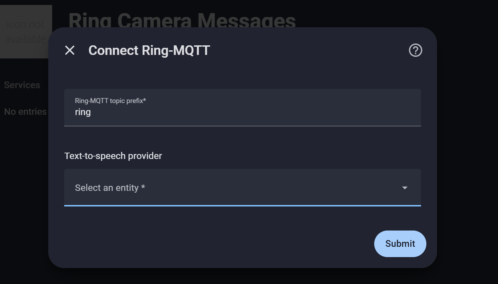
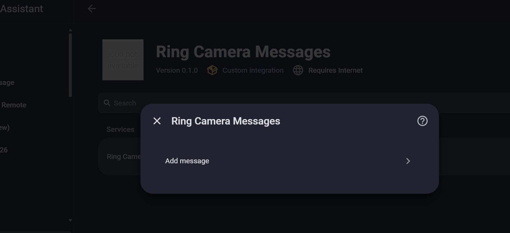
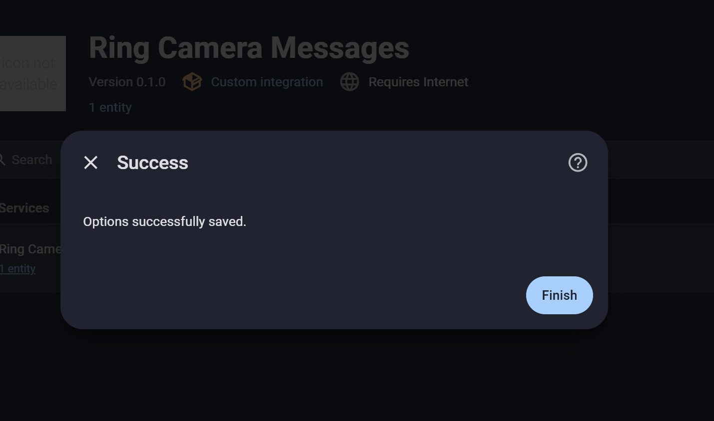

# Ring Camera Messages

Ring Camera Messages is a Home Assistant custom integration for sending your
own spoken messages through the built-in speakers on compatible Ring cameras
and video doorbells. Home Assistant turns your text into audio using your
chosen text-to-speech provider. Ring-MQTT receives that audio over MQTT and
plays it through the camera you select.

**A running, compatible Ring-MQTT bridge is required before setup.** The Home Assistant Marketplace
installs this integration. Install and configure Ring-MQTT
separately using a build that includes the speaker playback request feature.
[Download the compatible Ring-MQTT Speaker Bridge](https://github.com/EndOfTheLine-HA/ring-mqtt-speaker/releases/tag/v0.1.0).

## What you can do

- **Save messages as buttons.** Create several messages and choose a camera
  for each one. Put a delivery thank-you on the Front Door dashboard or send
  “Stop barking” through a side-yard camera.
- **Speak from an automation.** Call `ring_camera_messages.speak` with a camera
  ID and text. A Frigate-triggered Home Assistant automation can use a face
  recognition event to say “Welcome home, Alex” or play a preset after an audio
  or object detection.
- **Adjust quiet presets.** Set a volume boost from 0 to 18 dB per saved message.
  A peak limiter caps the signal, so the audible increase may be smaller.

One Home Assistant instance connects to one bridge, which can serve multiple
cameras. The bridge plays one clip at a time, up to 17 seconds per clip.
Playback has been tested on a Ring Doorbell Pro and a Floodlight Cam Pro.

## Prerequisites

- **Ring-MQTT** running and authenticated to Ring, with camera support enabled
  and `"enable_speaker_requests": true` in its standalone configuration.
  Install the linked standalone Docker build and restart Ring-MQTT after enabling the option.
- **Home Assistant 2026.11.0 or newer**, with Marketplace access and a
  configured text-to-speech entity. The optional preset volume boost uses
  the FFmpeg executable on the Home Assistant host.
- **A shared MQTT broker** connected to both Home Assistant and Ring-MQTT.
  Restrict write access to `<ring_topic>/speaker/v1/play` to trusted publishers.
  A maximum-length clip needs an MQTT payload allowance of about 4.36 MB.
- **A Ring camera or video doorbell** with Two-Way Talk and Live View enabled.
  Frigate is optional and is needed only for automations that use its events.

## Install

1. Open **Settings → Marketplace**, search for **Ring Camera Messages**, and
   open its listing. Install the integration and restart Home Assistant.
   If the listing is not available in search yet, use **Add from link** and
   enter `EndOfTheLine-HA/ring-camera-messages`. Choose **Integration** if prompted.
2. Go to **Settings → Devices & services → Add integration → Ring Camera Messages**.
   Select your text-to-speech entity and enter the Ring-MQTT topic prefix,
   usually `ring`.
3. Open **Configure → Add message** to create your first button. Test playback
   from its entity before adding it to a dashboard.

## Visual setup

After installing through the Marketplace and restarting Home Assistant, open
**Settings → Devices & services → Add integration → Ring Camera Messages**.

1. In **Connect Ring-MQTT**, keep the topic prefix as `ring` unless you changed
   it in your bridge configuration. Select a text-to-speech provider and submit.

   

2. After the integration connects, open **Configure → Add message**. Enter a
   button name, select the camera that should speak, and enter your message.

   

3. Submit the message and select **Finish**. Open the new button entity and
   press it to test playback before adding it to a dashboard.

   

For a dashboard card with a custom tap action, set the `button.press`
target to the same message button entity shown on the card.

## Automations

Use the **List cameras** action to find a stable camera ID. Pass it to
**Speak through Ring camera** with plain text or a Home Assistant template.

```yaml
action: ring_camera_messages.speak
data:
  camera: "123456789"
  message: "Thank you for the delivery."
```

See [the Frigate greeting example](examples/frigate-greeting.yaml) for a
face event, explicit name mapping and cooldown. Replace the example
camera names and ID before enabling it. A Frigate face update can be
published more than once and can be below the recognition threshold.

If playback fails, inspect the Home Assistant action trace and Ring-MQTT
logs. A successful action means the Ring playback session ended. Check
speaker volume and audibility at the camera.
